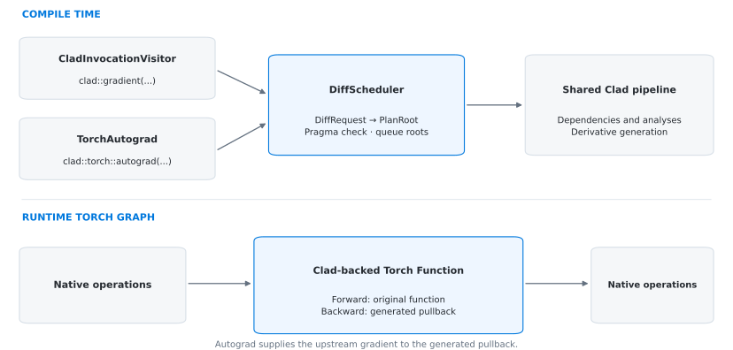
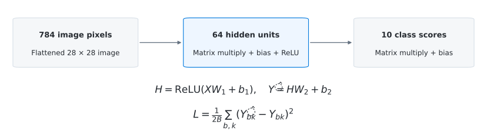
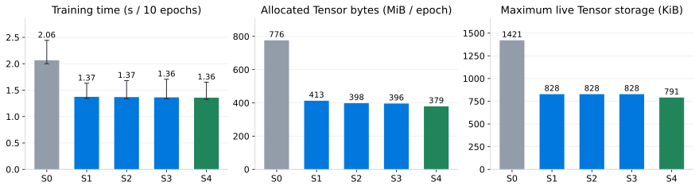
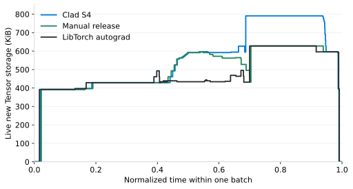

At the beginning of GSoC, I wanted to make Clad-generated derivatives usable
inside a LibTorch C++ training loop. LibTorch already provides Tensor storage,
optimized kernels, and an autograd engine. Clad can generate derivative code
while compiling C++. My project explored how these two systems could work
together for a supported subset of Tensor operations.

The result includes a Tensor derivative backend, a compiler frontend that
connects generated pullbacks to `torch::autograd::Function`, and an MNIST
training example with correctness tests and reproducible benchmarks. Several
compiler improvements developed along the way have been merged into Clad;
others remain under review.

Performance became a substantial part of the work. In our CPU MNIST experiment,
the optimized direct Clad path reduced measured training time by 15.4% relative
to native LibTorch autograd, but still used 26.0% more peak Tensor storage.
Investigating that remaining gap led to a useful finding: some generated
Tensor handles kept storage alive after its last use. A manual early-release
experiment brought the peak close to the native reference.

This report follows the implementation and the experiments behind those
results. It continues my [initial project introduction](https://compiler-research.org/blogs/gsoc26_kacent_introduction_blog/).

## Making Tensor derivatives work

The first challenge was representing derivatives of Tensor values correctly.
In reverse-mode AD, an *adjoint* accumulates contributions to a value's
derivative. A scalar adjoint can start at `0`. A Tensor adjoint also needs the
right shape, dtype, and device, with storage independent of the original value.

Copying a Tensor copies its handle and shares the underlying storage. Clearing
that copy can therefore overwrite the original data. Default construction has
a different problem: it creates an undefined Tensor, without the runtime shape
needed by a pullback that writes into it.

I introduced `clad::zero_like` to express construction of a zero adjoint from an
existing value. For a defined floating-point CPU Tensor, the essential rule is:

```cpp
namespace clad {
at::Tensor zero_like(const at::Tensor& value) {
  at::NoGradGuard guard;
  return at::zeros_like(value);
}
}
```

This also separates construction from `zero_init`, which resets an existing
adjoint. Subsequent changes let Clad reuse the type-level rule when constructing
default reverse-forward results and centralize its use in adjoint generation.
An ordinary function returning a Tensor by value no longer needs its own
`reverse_forw` helper just to repeat the same initialization rule. Explicit
helpers still serve cases involving aliasing or additional saved state.

The operator derivatives are a separate layer. I implemented custom pullbacks
for the supported Tensor operations, including arithmetic, reductions, ReLU,
matrix multiplication, and views. Clad composes these rules into the derivative
of the user's C++ function. LibTorch executes the underlying kernels; Clad does
not need to differentiate their implementations.

Broadcasting and strided views made this more than a collection of scalar
formulas. For example, a broadcast bias receives the sum of contributions over
the expanded dimensions. Tensor copies and moves also require care because
shared primal storage does not imply that independent local adjoints should
share storage. Tests cover these cases alongside the simpler contiguous path.

## Separating entry discovery from derivative planning

Clad traditionally discovers differentiation requests through calls such as
`clad::gradient`. The Torch integration needs to request a derivative from a
different entry point, while retaining Clad's dependency planning and analyses.

I separated ordinary Clad invocation discovery into `CladInvocationVisitor`.
The Torch frontend has its own visitor, and both describe the required work
with a `DiffRequest`. A shared `DiffScheduler::PlanRoot` submits those requests
to the planner. The scheduler checks the invocation's `#pragma clad` interval
and queues roots discovered while another request is being planned.



This keeps frontend-specific recognition separate from derivative generation.
Adding a Torch entry point does not require a second AD engine, and ordinary
Clad calls continue through the same planning infrastructure. The refactor is
tracked in [PR #2376](https://github.com/vgvassilev/clad/pull/2376).

## Connecting a pullback to Torch autograd

For a supported function, the explicit entry point looks like this:

```cpp
using Tensor = at::Tensor;

Tensor block(const Tensor& x, const Tensor& weight) {
  return (x * weight).relu();
}

// x and weight are CPU floating-point Tensors requiring gradients.
auto y = clad::torch::autograd(block, "x,weight", x, weight);
y.sum().backward();
```

The frontend identifies `block`, requests a pullback, and replaces the entry
call with an adapter based on `torch::autograd::Function`. Conceptually, the
replacement is:

```cpp
using Node = clad::torch::detail::AutogradFunction<block, block_pullback>;
auto y = Node::apply(x, weight);
```

The adapter's forward method runs the original function and saves its inputs.
During backward, Torch supplies the output's upstream gradient, and the adapter
passes it to the generated pullback. The returned input gradients then continue
through the surrounding Torch graph. A `CLAD_TORCH_AUTOGRAD` annotation also
allows supported direct calls to request this integration.

A pullback is the appropriate interface here because its output seed can be
arbitrary. A scalar-loss gradient entry normally starts the reverse pass with
a seed of one; a function embedded in a larger computation must receive the
contribution from that computation instead. PyTorch's [C++ autograd interface](https://docs.pytorch.org/tutorials/advanced/cpp_autograd.html)
provides this forward/backward boundary.

The prototype targets first-order derivatives of supported CPU Tensor
functions. Torch still manages the surrounding graph. Within a Clad-backed
region, the generated pullback supplies the backward program. Separate
integration tests check this boundary, including composition with native
autograd and upstream gradients that are not simply one.

## Validating a complete training workload

I used MNIST to move beyond individual operator tests. The model has a
784-to-64 hidden layer with ReLU and a 64-to-10 output layer. Its loss is the
sum of squared differences from one-hot targets, divided by twice the batch
size. Training uses mini-batch SGD with batch size 128 and learning rate 0.05.



LibTorch loads the data and executes Tensor kernels. Clad generates the loss
derivative for both weight matrices and both biases. Gradient checks compare
against native autograd and central finite differences, including strided
weights. The training runs use all 60,000 training images and 10,000 test
images for ten epochs.

For the detailed optimization experiments below, I call `clad::gradient`
directly under `NoGradGuard`. This measures the generated training path without
the Torch Function adapter. The native reference uses the same training loop,
initialization, batches, and SGD updates with LibTorch autograd. Keeping these
paths separate makes the benchmark's scope explicit.

All stages in the experiment reached 93.9% test accuracy, and their final
parameters had a maximum absolute difference of zero from the native reference
in this run. Correctness checks also run independently of full training, so a
similar accuracy alone is not our test of the derivatives.

## Removing work from the generated backward pass

Before the staged experiment, I put the model's forward operations directly
inside the differentiated loss. With a separate prediction helper, an ordinary
generated pullback can recompute the helper's intermediates because its
interface does not receive those values from the earlier forward call. Keeping
the operations in the root function lets its reverse sweep reuse local values.
This is already part of S0, the baseline below.

S0 also uses native ReLU backward kernels and ordinary `zero_like` semantics.
The Tensor backend had earlier explored representing zero with an undefined
Tensor. The final backend constructs real zero adjoints, so custom pullbacks
can work with them normally; the later optimizations focus on avoiding work
and reusing storage where the operation permits it.

### S1 omits gradients for fixed data

The loss requests gradients for the model parameters, but the original full
matrix pullback also computes an image gradient. For `Y = XW` and upstream
gradient `G`, the weight contribution is `XᵀG`, while the image contribution is
`GWᵀ`. This training loop needs the former. The latter costs another matrix
product and a 128-by-784 buffer.

Selecting gradient outputs alone is not generally permission to omit every
other adjoint. An unselected parameter can be overwritten with an active value
and become an intermediate in the derivative. I added the explicit option
`assume_unselected_inactive` for callers who can promise that unselected root
inputs, including their reachable storage, remain inactive. The fixed images
and targets in this workload satisfy that promise.

I also added `clad::no_adjoint`, an empty type that preserves an omitted
gradient's position in a pullback signature. A small scalar example is:

```cpp
// product(data, weight) = data * weight
namespace clad::custom_derivatives {
void product_pullback(double data, double /*weight*/, double seed,
                      clad::no_adjoint, double* d_weight) {
  *d_weight += data * seed;
}
}
```

Clad can select this overload when only the weight contribution is needed.
The same approach applies to the Tensor matrix pullback. Selection happens
while compiling. Generated pullbacks also retain
omitted positions with the marker, distinguishing output subsets whose
remaining pointer types would otherwise be identical. Existing full custom
pullbacks remain usable through a fallback with real output storage.

Varied Analysis, enabled by `enable_va`, is already present in S0. It tracks
which values depend on selected inputs, but a full handwritten custom pullback
still contains its own computations. The partial overload gives Clad an
implementation that actually omits the unwanted output work.

### S2 and S3 reduce allocation and copying

In S2, matrix pullbacks accumulate directly into existing gradient storage with
`addmm_`, where dtype and aliasing conditions permit. This avoids materializing
a separate matrix product and then adding it to the destination.

S3 groups further buffer improvements: elementwise accumulating kernels,
copy-adjoint propagation without a redundant temporary, and reuse of a ReLU
seed when ownership permits. Ownership matters because moving a Tensor handle
does not remove other aliases. Borrowed or shared storage must remain protected.

### S4 removes an unused default adjoint

Inspection of the generated code revealed another allocation source. While
processing a temporary member-call receiver, the outer visitor could already
provide its adjoint. Visiting the inner call could nevertheless create a
second default adjoint through `zero_like`. The outer visitor then replaced
that returned adjoint reference, leaving the extra initialization unused.

I fixed this specific case in [PR #2496](https://github.com/vgvassilev/clad/pull/2496).
The MNIST derivative loses three allocations per batch. This is compiler-side
work elimination: the extra Tensor never needs to be constructed.

## Measuring the changes

The experiment uses Clang 21.1.3 with `-O3`, LibTorch 2.11 CPU, FP32, and one
thread pinned to CPU 0. Each case has six timing runs in rotated order. Timing
includes batch copies, forward, backward, and SGD, and excludes data loading,
shuffle preparation, evaluation, and serialization. The reported ten-epoch
time is the sum of the per-epoch medians across those runs.

Memory instrumentation runs separately. It counts newly allocated CPU Tensor
storage during training, excluding pre-existing datasets and model storage,
allocator reservations, and C++ graph metadata. Allocation volume measures
all bytes allocated during an epoch; peak live storage measures how many of
those bytes coexist.

| Case | Training time (s) | Allocated per epoch (MiB) | Peak live storage (KiB) | Allocations per batch |
|---|---:|---:|---:|---:|
| S0 baseline | 2.065 | 776.3 | 1420.8 | 35 |
| S1 partial pullbacks | 1.373 | 412.9 | 827.8 | 29 |
| S2 direct matrix accumulation | 1.369 | 398.2 | 827.8 | 28 |
| S3 buffer improvements | 1.363 | 395.9 | 827.8 | 27 |
| S4 unused-adjoint fix | 1.357 | 379.0 | 790.8 | 24 |
| Native LibTorch autograd | 1.603 | 359.8 | 627.8 | 27 |



The time error bars show the minimum and maximum total training times across
the six runs. The largest improvement is S0 to S1: training time falls by
33.5%, and peak storage by 41.7%. Later stages mainly reduce allocations.

The [raw timing and allocation measurements](/assets/docs/gsoc26-kacent-final/ablation-raw.csv),
[ablation summary](/assets/docs/gsoc26-kacent-final/ablation-summary.json), and
[memory lifetime summary](/assets/docs/gsoc26-kacent-final/lifetime-summary.json)
are available alongside this report.

## Understanding the remaining memory gap

A Tensor's last numerical use does not necessarily end its lifetime. A local
handle can keep storage alive until the function returns, and another handle
can retain an alias even after the first is moved. Generated code contained
patterns like this:

```cpp
Tensor saved_adjoint = clad::zero_like(hidden);
Tensor d_hidden = saved_adjoint;  // Another handle to the same storage.
// ... backward computations use d_hidden ...
```

Even when the backward computation finishes using `d_hidden`, the redundant
`saved_adjoint` handle can retain that storage. Forward intermediates also
remain live beyond their last backward use. This explains why eliminating
allocations alone does not necessarily bring the peak down to native autograd.

To test the cause, I edited a copy of the generated derivative and inserted
`Tensor::reset()` after the last use of each local handle. The experiment kept
the derivative formulas and real `zero_like` initialization. Releasing a
redundant gradient alias also made a ReLU seed uniquely owned, enabling an
existing kernel to reuse it.



The peak fell from 809,772 bytes to 642,856 bytes, a 20.6% reduction. Native
autograd used 642,864 bytes, just eight bytes more. Final parameters still
matched, accuracy remained 93.9%, and newly tracked storage returned to zero
at every batch end.

## Contributions to Clad

The integration exposed issues that also matter to other C++ types and
frontends. The following groups summarize the related compiler contributions.
Statuses are recorded as of November 5, 2026.

| Contribution | Pull requests | Status |
|---|---|---|
| Construct zero adjoints from values and reuse the rule across generation paths | [#1932](https://github.com/vgvassilev/clad/pull/1932), [#2068](https://github.com/vgvassilev/clad/pull/2068), [#2336](https://github.com/vgvassilev/clad/pull/2336), [#2353](https://github.com/vgvassilev/clad/pull/2353) | Merged |
| Correct derivative lookup, temporary cloning, return handling, default initializers, and member calls | [#1832](https://github.com/vgvassilev/clad/pull/1832), [#1926](https://github.com/vgvassilev/clad/pull/1926), [#2066](https://github.com/vgvassilev/clad/pull/2066), [#2067](https://github.com/vgvassilev/clad/pull/2067), [#2165](https://github.com/vgvassilev/clad/pull/2165), [#2168](https://github.com/vgvassilev/clad/pull/2168) | Merged |
| Respect closed pragma intervals | [#2175](https://github.com/vgvassilev/clad/pull/2175) | Merged |
| Separate entry discovery from shared request planning | [#2376](https://github.com/vgvassilev/clad/pull/2376) | Open |
| Support partial pullbacks and the inactive-input assumption | [#2495](https://github.com/vgvassilev/clad/pull/2495) | Open |
| Avoid unused default adjoints for temporary receivers | [#2496](https://github.com/vgvassilev/clad/pull/2496) | Open |

The LibTorch backend, adapter, tests, and benchmarks are developed in the
[project fork](https://github.com/fogsong233/clad). They build on these compiler
changes. I plan to submit the integration upstream once the supporting mechanisms
have been merged.

## Next steps

Two compiler improvements follow directly from the experiments. First,
generated pullbacks should be able to reuse the values produced by a separate
forward helper. Clad already provides [`pullback_state`](https://github.com/vgvassilev/clad/blob/master/test/Gradient/PullbackState.C) for a custom
`reverse_forw`/pullback pair to exchange per-call state. The next step is to
automate the selection and transport of saved values for generated functions.

Second, generated code should release Tensor storage once no later operation
needs it. The manual experiment gives a concrete target, but general support
must account for control flow, aliases, escaped references, and the type's
release semantics. These two directions address complementary costs:
recomputation across function boundaries and excessive lifetimes within a
generated function.

I would like to thank my mentors Aaron Jomy, David Lange, and Vassil Vassilev. Their feedback
helped turn problems encountered in one Tensor backend into improvements that
other Clad users can build on.
